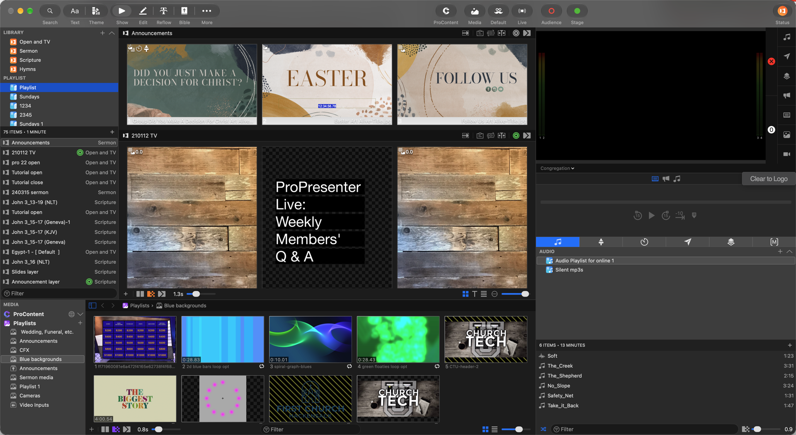
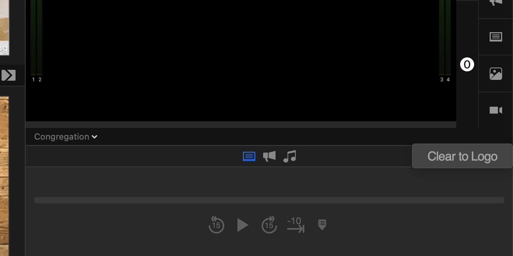
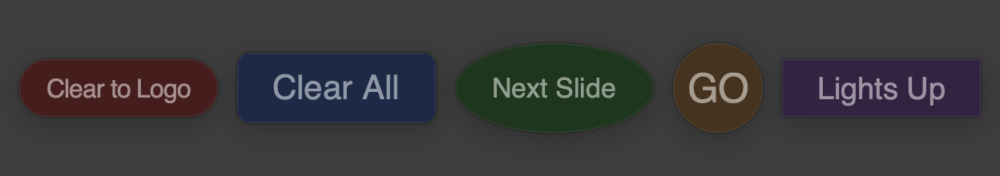
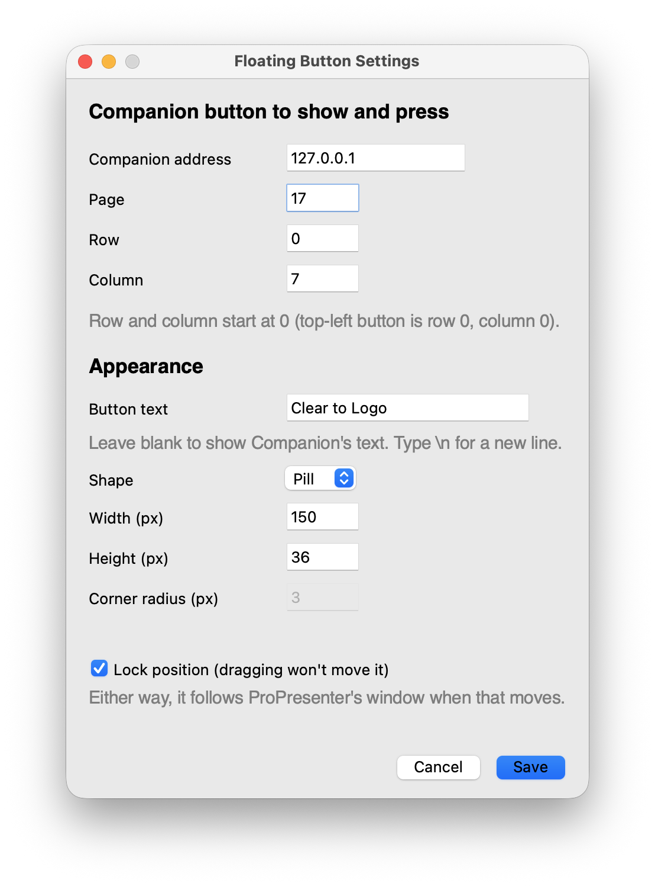

# Companion Floating Button

A small always-on-top button that sits over ProPresenter and presses a [Bitfocus Companion](https://bitfocus.io/companion) button for you. It shows that button's live text and colour, so it always says what it does.

Made by Trinity Digital Media, LLC (ChurchTechU). Not affiliated with Bitfocus or Renewed Vision.

Pick your own text, size and shape. Once it's linked, it takes on the Companion button's colour:

## Download

Get the latest version from the Releases page:
https://github.com/sempei13/companion-floating-button/releases
| Computer | File |
|---|---|
| Mac with Apple Silicon (M1, M2, M3, M4...) | `Companion-Floating-Button-mac-apple-silicon.dmg` |
| Mac with Intel processor | `Companion-Floating-Button-mac-intel.dmg` |
| Windows 11 | `Companion-Floating-Button-windows-setup.exe` |

Not sure which Mac you have? Apple menu > About This Mac. "Chip: Apple M..." means Apple Silicon; "Processor: Intel" means Intel.

## Install

**Mac**
1. Open the `.dmg` and drag **Companion Floating Button** into **Applications**.
2. Open it from Applications. The first time, macOS will say it can't verify the app. Click **Done**, then go to **System Settings > Privacy & Security**, scroll down, and click **Open Anyway** next to Companion Floating Button.

**Windows 11**
1. Run `Companion-Floating-Button-windows-setup.exe`.
2. If Windows shows "Windows protected your PC", click **More info**, then **Run anyway**.
3. Follow the installer. You can add a desktop shortcut and have it start when you sign in.

## Set up Companion (one time)

In Companion's web page, go to **Settings > Protocols** and turn on **Enable Button Subscriptions API** (in the Satellite section). This lets the floating button show your button's text and colour.

Heads up: with that setting on, any Satellite client that can reach your Companion computer can press any button, bypassing the PIN/page lock. On a network where guests or volunteers share the Wi-Fi, keep that in mind.

Without the setting, the button still presses your Companion button but just says "CLEAR" on a flat grey face. Once it's linked, it takes on your Companion button's colour, toned down to match ProPresenter's dark style.

## Use it

- **Click** to press the Companion button.
- **Drag** to move it. It remembers where you leave it.
- **Right-click** (or Control-click on a Mac) for the menu:
  - **Settings...**: choose the Companion computer's address and which button (page, row, column). Row and column start at 0, so the top-left button is row 0, column 0. Under **Appearance**:
    - **Button text**: your own words in place of Companion's text (type `\n` for a second line). Leave it blank to show whatever Companion says. The colour still comes from Companion.
    - **Shape**: Rounded rectangle (set the corner radius; 0 gives square corners), Pill, Oval, or Circle.
    - **Width / Height**: the size in pixels (width 40-600, height 20-300; a circle uses the width for both). The text grows with the button and shrinks to fit.
    - Changes preview on the button as you type. **Cancel** puts it back.
    - **Lock position**: dragging won't move the button, so you can't knock it out of place mid-service. Clicking still presses it, and pulling on it more than a few pixels cancels the click. The "Move to..." menu items still work.
  - **Only show over ProPresenter**: when ticked, the button only appears when ProPresenter's window is directly under it. It's off the first time you open the app, so you can find the button and set it up, and turns on from the second launch (unless you've changed it yourself).
  - **Only show in Show, Reflow & Bible** (Mac only, on by default): hides the button while ProPresenter is in Edit or More, since there's nothing on screen to clear from there. It reads ProPresenter's toolbar through macOS Accessibility, so the first time, macOS asks you to allow **Companion Floating Button** in **System Settings > Privacy & Security > Accessibility**. Until you allow it, this setting does nothing and the button stays visible.
  - **Move to Display**: sends the button to another monitor, keeping its relative spot (near the right edge stays near the right edge).
  - **Move to top-left**: brings it back if it ever ends up off-screen.
  - **Quit**
- **It follows ProPresenter.** Put the button on ProPresenter's window and it remembers its spot relative to the nearest corner. When you move or resize ProPresenter, the button moves with it, locked or not. If ProPresenter is minimised or closed, the button stays where it is and catches up when the window comes back. A button placed off ProPresenter just floats where you left it.
- **Mac only:** the same "Move to..." choices are in the app's **Dock menu** (right-click its Dock icon) and its **Window** menu in the menu bar. These work even while the button is hidden.

When "Only show over ProPresenter" is on and ProPresenter isn't showing, the button (and its right-click menu) is hidden. Bring ProPresenter to the front to reach it, or on a Mac use the Dock menu to move it to the display ProPresenter is on.

## Requirements

- Bitfocus Companion 4.1 or newer (tested with 5.1.3), reachable from this computer.
- A Mac (tested on macOS 26) or a Windows 11 PC (64-bit).

## For developers

Run from source with Python 3.12 (Tk 9 recommended): `python floating_button.py`.
Installers are built by `.github/workflows/build.yml` on every push to `main`; pushing a `v*` tag publishes a Release. Icons are generated by `packaging/make_icons.py`.
